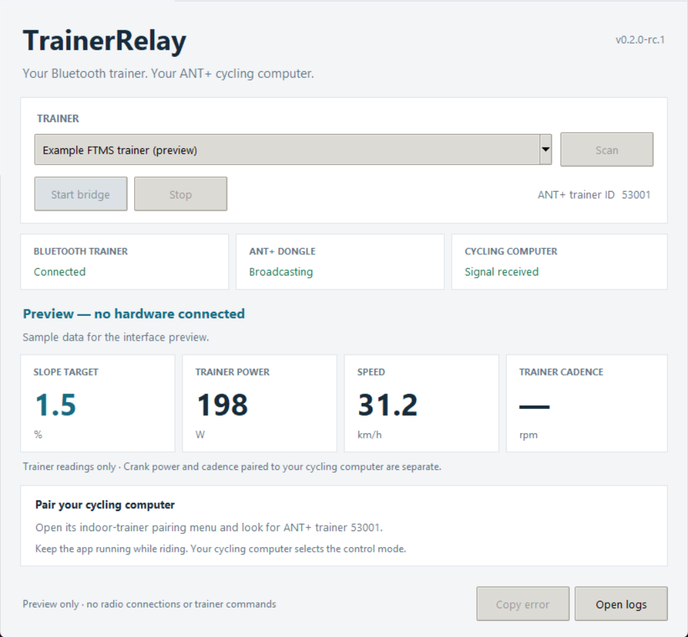

<div align="center">
  
  <h1>TrainerRelay</h1>
  <p>A small Windows bridge between your Bluetooth trainer and ANT+ cycling computer.</p>

  [](https://github.com/eliseobao/trainer-relay/actions/workflows/windows.yml)
  [](https://github.com/eliseobao/trainer-relay/releases)
  [](LICENSE)

  **[Download for Windows](https://github.com/eliseobao/trainer-relay/releases)** · **[Setup & help](docs/guide.md)** · **[What's new](CHANGELOG.md)**
</div>

<br>



Your cycling computer runs the ride. TrainerRelay passes its targets to the trainer and sends the trainer's readings back. No account, cloud connection, or workout dashboard.

```text
Cycling computer  ⇄  ANT+ USB stick + TrainerRelay  ⇄  Bluetooth trainer
```

## Ready to ride

1. Extract the Windows ZIP and open **TrainerRelay.exe**.
2. Plug in the ANT+ stick, wake your trainer, and close other apps using it.
3. **Scan → select your trainer → Start bridge.**
4. On your cycling computer, pair indoor trainer **53001**. Keep it near the USB stick while pairing.
5. Start your ride. Leave TrainerRelay running and the laptop awake.

**You need:** Windows x64 with Bluetooth LE, an FTMS trainer, a supported ANT USB stick with the libusb-win32 driver, and a cycling computer with ANT+ FE-C trainer control. Python is included in the download. The app is unsigned.

The **D100 + Edge 530** is the priority setup. [Driver setup and Edge pairing](docs/guide.md) are explained in the guide.

## Three ways to ride

| Mode | What the cycling computer sends | Status |
| --- | --- | --- |
| **ERG** | A power target, such as 200 W | Verified on the D100 + Edge 530 |
| **Slope** | Grade, wind, and rolling resistance | Implemented; hardware test pending |
| **Resistance** | A level from 0–100% | Implemented; hardware test pending |

The **0.2 preview** adds slope and resistance. It reads the trainer's features before enabling them; resistance also needs a usable native range. These new modes have automated protocol tests, but have not yet been checked on the physical D100. The earlier **0.1.0 ERG-only release** remains available.

## Just a bridge

The window shows the active target, trainer power, speed, and cadence when the trainer provides it. Crank power and cadence paired directly to your cycling computer remain separate. There is no PowerMatch, calibration, activity recording, or workout loading.

Power targets are capped at **600 W**. Slope follows the requested grade; the trainer determines how much resistance it can physically produce. Resistance percentages are mapped across the trainer's advertised levels, rather than treated as watts. [More about the modes](docs/guide.md#control-modes).

Click **Stop** before unplugging anything. If a connection is already lost, the app may not be able to deliver the stop command.

---

**Need help?** [Read the guide](docs/guide.md), or [open an issue](https://github.com/eliseobao/trainer-relay/issues/new/choose) with the error and a redacted log.

**Want to build it?** [Development & releases](docs/development.md) · [Contributing](CONTRIBUTING.md) · [Third-party notices](THIRD_PARTY_NOTICES.md)

MIT © eliseobao. Not affiliated with the device manufacturers.
